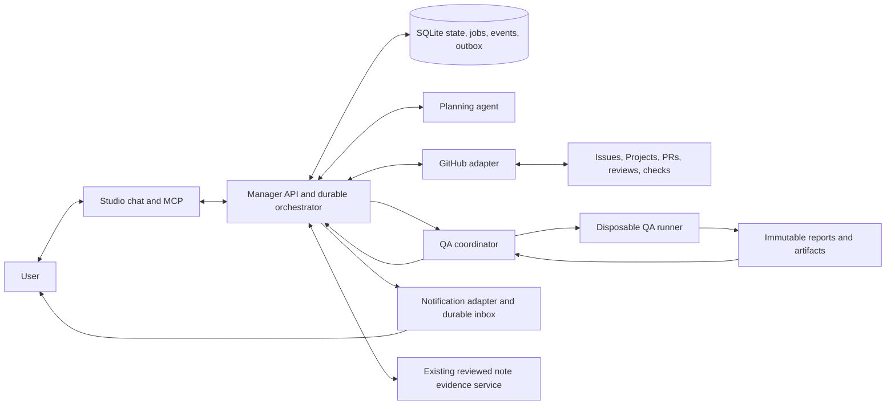

# Project manager: GitHub planning and QA delivery system

Historical agent contribution. The [canonical system design](github-delivery-system-design.md) incorporates later simulation and review corrections; use that document for implementation.

Design draft, 2026-10-30. Author: system design agent. Scope: `elisealcala/chore-design` and `elisealcala/agents`. Requirements: DEC-007 and `memory-bank/plans/0001-github-delivery-loop.md`.

This document describes the target system. The existing local pilot implements evidence intake, human fact review, questions and traces; it does not implement the delivery loop below. No operational GitHub actions are performed by this design.

## The result the user experiences

The user talks to one project manager about both repositories. The manager explains current status with links and freshness, keeps a small prioritized backlog, creates complete issues, and asks for decisions only when needed. The user selects an issue and works with Codex to open a PR. The manager notices the PR, commissions independent QA, publishes findings, waits for corrections, and merges the verified result when repository rules permit. It then updates progress and the next available ticket. When the user is away, the manager continues monitoring and sends a message for a blocker, required decision or useful new idea. An unchanged state produces no message.

Planning and QA are reasoning roles. The orchestrator is a persistent application that controls state and actions. A model can propose a ticket or verdict, but cannot bypass readiness, identity, QA or merge rules by emitting text.

## Components and deployment

Use the current TypeScript service and SQLite for this personal two-repo workload. Deploy one persistent manager process on a small always-on Linux VM, with supervised containers for the manager, classifier and same-origin Studio, encrypted durable volumes, daily database/artifact backup and restore verification. Put authenticated TLS at the host entry point; initially use one host and one SQLite owner rather than distributed workers writing the database. Its timer polls GitHub at a proposed 60-second interval with pagination, incremental cursors and conditional requests; it performs a broader periodic reconciliation to recover missed updates. Polling avoids requiring an internet-facing webhook endpoint in the first complete release. Add verified signed webhooks later as a latency optimization, retaining reconciliation. A sleeping laptop is not the always-on host.

The manager alone owns the database and durable scheduler. QA jobs run in separate disposable environments and return signed/authenticated completion messages. Keep the classifier as the independent evidence server; it is not the job scheduler. Studio and MCP call the same service and see the same state. Hosted deployment requires authenticated TLS transport; the current localhost-only unauthenticated server and MCP client origin restriction must be adapted deliberately. Keep localhost support for development.

Notification has two layers: a durable Studio inbox and bot-authored comments on one dedicated coordination issue per repo, mentioning `@elisealcala` and linking to the decision in Studio. Record acknowledgement in chat or the inbox. GitHub notification delivery depends on the user's settings; onboarding must send a test mention and obtain an acknowledgement before proactive operation is ready. Posting a comment is a transport event, not proof the user received/read it. Keep unacknowledged decisions visibly pending and use a configured fallback channel if notification preflight fails. Deduplicate by meaningful change and do not repeatedly mention the user about an unchanged blocker.

## Ownership and authority

| State | Authority | Handling |
| --- | --- | --- |
| PR identity, head, merge result, check runs and issue state | Fresh GitHub API response | Store an observed projection with immutable response/event references and fetched time. No manual approval of observed facts. |
| Goals, priorities, scope decisions and delegation rules | Explicit user instruction | Record a typed decision linked to conversation turn, applicable repos and revision. Make the resulting action visible. |
| Task or status inferred from prose | Existing candidate review pipeline | Keep pending until human review. Never turn a README capability or procedure into a completed task. |
| Backlog plan, estimates and new ideas | Planner proposal | Label as proposed until covered by agreed goals/delegation; do not represent as observed progress. |
| QA conclusion | QA report plus execution evidence | A result for one PR/head/base/criteria/policy revision, never general approval of a branch forever. |
| Merge | Successful GitHub response or subsequent reconciliation | Never mark done because a merge request was sent or a review was approved. |

GitHub is the user's operational work surface. The manager database holds decisions, provenance, orchestration and projections. Projects fields mirror manager planning state; issues and PRs remain canonical for their GitHub state. Every managed field has an owner and last-observed revision. If the user changes a manager-owned priority/status field on GitHub, import it as a human edit and reconcile the plan; do not overwrite it with stale local state. An issue closed without a qualifying merge is `closed_unverified` or `cancelled`, never delivered automatically.

Use two manager projects, one per repository, and explicit cross-project dependency edges. The collection contains independent agents: no background scanning of their memory banks, and no merging their development memory into a portfolio bank. The manager consumes GitHub issues, PRs, checks and allowlisted public product docs. Authoritative repo instructions are applied when executing work in a checkout. Product notes from another agent's memory require an explicit permitted handoff, rather than reading that bank as a shortcut. QA for `agents` targets the affected agent packages; a collection-wide ticket must explicitly define broader impact and checks.

## Records

Use versioned relational tables alongside the legacy JSON project records, with migration bookkeeping and explicit foreign keys. All records carry `workspaceId`, manager `projectId`, repository immutable node/numeric ID and human-readable `owner/name` when relevant. GitHub IDs survive repository renames; display URLs are not primary keys.

- `RepositoryBinding`: manager project, repo ID, owner/name, default branch, GitHub Project ID, field IDs, integration identities, enabled actions and policy revision. One binding is created or adopted per repo; lookup precedes creation.
- `ObservedObject` and `SourceSnapshot`: issue/PR/check/Project snapshots, source IDs, timestamps, content hash, fetched time and freshness. Keep raw needed evidence without secrets.
- `Goal`, `Decision`, `WorkItem`: user outcome and agreed scope; issue ID; problem/context, proposed behavior, acceptance criteria IDs, dependencies, priority/rationale, component/check profile, evidence requirements, lifecycle and revision.
- `Dependency`: typed edge with source and target repo/item IDs; satisfied, waiting, blocked or invalid-cycle status. Cross-repo edges are explicit and no-memory-sharing.
- `Job`, `EventInbox`, `ActionOutbox`: durable event deduplication, leased work with attempt/deadline, remote operation intent, reconciliation state and unique logical operation key.
- `PRBinding`: repo/PR ID, linked WorkItems and criteria revisions, head/base SHA, draft status, observed check/review IDs, last update and QA state.
- `QAJob`, `QAReport`, `Artifact`: exact inputs, isolated environment profile, commands/test definitions, exits, findings/severity, criterion-to-evidence coverage, artifact checksums and references, conclusion, reviewer identity and attestation.
- `Notification`: reason/fingerprint, related object and revision, content, channel, delivery attempt/provider ID, delivered time, acknowledgement and resolution.

A ticket's acceptance criteria are versioned. Material changes during implementation invalidate the old ticket readiness and associated QA. The user can explicitly waive or change a requirement with recorded rationale; the planner cannot quietly lower it to obtain a pass.

## Direct conversations and planning

Add a conversation interface that reads a bounded status dossier: project names, goals, current observed work with source links/freshness, accepted decisions, pending proposals, blockers, QA and recent actions. The existing answer model currently receives approved facts and history but lacks project name; correct that context gap. Existing note-question tools remain backward compatible; introduce separate typed operation tools such as `get_delivery_status`, `record_decision`, `plan_work`, `create_ticket`, `get_qa_report`, and `get_notifications` with explicit scope and revisions.

A conversation can read both repos only after selecting explicit portfolio scope. A question concerning one repo must never use another repo's issue # or facts accidentally. Unknown or stale GitHub state is stated as unknown/stale, and a refresh is queued.

At setup, record outcomes, relative repo priority, a proposed total implementation WIP limit of one, ticket size preference, and delegated actions. Within agreed goals, the manager may refine/create tickets and move priorities without per-action permission. A new strategic goal, conflicting user decision, missing product choice or spending limit becomes one concrete decision request. New ideas are sent with rationale, evidence and likely value, then wait for the user's decision before becoming committed work. No deadlines or assignments are invented.

Ticket readiness requires: concrete problem and value; scoped behavior and exclusions; affected component; numbered observable acceptance criteria; reproducible verification/evidence expectations; dependencies; priority rationale; and no unresolved product decision that blocks implementation. The generated issue contains those fields and links to relevant decisions and docs. The manager adopts existing suitable issues and Projects instead of duplicating them. For both repos it creates or adopts a per-repo GitHub Project, fields for lifecycle/priority/blocker and issue links, then returns URLs. Initial inventory is required before generating new tickets. The design does not assume the repos have no prior backlog.

The planner proposes priority using explicit user overrides first, then blockers/dependencies, risk and outcome value, with effort as a stated uncertainty. The orchestrator validates cycles, WIP and scope. The suggested next ticket is ready and dependency-unblocked; if none qualifies, the manager explains what decision or prerequisite unlocks progress.

## PR and QA workflow

Track issue stage and PR QA stage separately. Issue lifecycle is `proposed → ready → in_progress → in_review → done`, with `cancelled` and `closed_unverified` outcomes. PR QA lifecycle is `observed → waiting_ready → queued → running → changes_requested → queued → approved → merging → merged`; superseded/closed PRs retain their history. Independent flags expose `blocked`, `awaiting_decision`, `infra_error` and `sync_pending`; failures do not erase the prior lifecycle. One issue may require several PRs and one PR may serve several issues; an explicit per-issue criterion coverage map determines completion, so merging one partial PR never closes all linked issues automatically. An unrelated PR can be observed without being managed. The manager binds only allowlisted-repo PRs with explicit linked tickets or a user linking decision.

1. Detect a ready-for-review linked PR. A draft PR waits; opening a PR never implies finished work. Snapshot the ticket criteria revision, PR diff, head/base SHAs and author-supplied evidence.
2. Create a QA plan covering every acceptance criterion, changed component contracts, regression risk and applicable repo checks. Pin the plan to trusted control-plane policy/profile revisions, not scripts or permissions modified by the PR. When the `agents` repo changes the manager itself, run the candidate separately while the current deployed control plane and merge rules remain authoritative; promotion is an explicit versioned deployment step after merged verification. A PR cannot relax its own QA requirements or replace its own attestation verifier. Author evidence is a hint and an artifact to verify, not proof of success.
3. Dispatch a disposable runner with read-only source at the exact commit, a trusted execution profile, resource/time budget and a restricted artifact-upload capability. No GitHub write token, manager database, cloud credentials or notification secrets enter the test environment. Tests/scripts from PR code are untrusted; execute them only inside the isolated environment. Untrusted diffs or reports cannot issue control-plane instructions.
4. Run appropriate type/lint/unit/integration checks and browser or API acceptance scenarios. For UI work, include screenshots/traces for the relevant sizes/flows. For changed agent packages, check relevant contracts and regression suites. If a criterion requires unavailable credentials, humans or environments, report it as not verified and request the smallest missing evidence; never count skipped checks as passing.
5. Produce an immutable report: criteria coverage, commands/results, findings with verified file/line context, reproduction steps, artifact hashes, environment and exact SHAs. The QA reasoning agent has independent instructions and sees requirements plus code/evidence; it does not inherit the implementation agent's claimed conclusion.
6. Deterministic rules classify `pass`, `changes_required`, `inconclusive` or `infra_error`. A model can surface findings; missing required criteria/checks or unresolved blocking findings prevent pass. Publish one summary and actionable inline comments where coordinates are verified. Use a separate GitHub identity eligible to review the PR. If identity or GitHub rules make approval impossible, expose a configuration blocker; do not counterfeit approval.
7. Any new commit, criteria revision, relevant policy change or integration-base change invalidates affected QA and merge authorization. Keep historical reports but queue current verification. Corrections loop through the user and Codex; QA does not silently rewrite production code.

Initially verify the PR branch and a reproducible temporary merge with the current base. Record both head and base. If merge queue is enabled, its merge-group checks must be supported; otherwise start with ordinary protected-branch merges. A base change requires revalidation appropriate to the integration checks before merge; protected up-to-date/check rules provide the server-side safeguard against the final race. Do not claim client-side re-fetch makes base movement atomic.

## GitHub integration and merge policy

Use a dedicated GitHub App/service identity for manager operations and QA reviews, distinct from the user's PR author identity. Scope installation to the two repos. Keep token minting and writes in the trusted adapter. The planner/runner receive no arbitrary token access. For these personal-owner Projects, use a separate owner-authorized token with the documented `project` scope in the Projects adapter; keep it outside QA execution. Use an installation App token for repo issue/PR/review/merge actions. Owner-level Projects capability is not implied by repository admin access, and `GITHUB_TOKEN` cannot access Projects. Verify each installed permission and bot review eligibility at onboarding. The available Codex chat connector has no Projects operations in this session, so the independent runtime requires a direct GraphQL Projects V2 adapter. Create/adopt one Project per repo and expose a portfolio view in Studio.

Required logical adapter methods: discover/adopt/create Project; discover fields/options; list/create/update/link Project items; list/read/create/update issues; list/read PRs and diffs; read checks/rules/reviews; publish reviews/comments; conditional merge with expected head; read merge result. Persist stable node IDs and pagination cursors. Integration tests must verify these capabilities with the actual app and both repo bindings before enabling automated writes. Use GraphQL `createProjectV2`, `addProjectV2ItemById` and `updateProjectV2ItemFieldValue` with owner/item/field node IDs, and REST issue/PR/review operations. This split and the identity constraints are supported by [GitHub Projects automation](https://docs.github.com/en/issues/planning-and-tracking-with-projects/automating-your-project/automating-projects-using-actions), [Projects API](https://docs.github.com/en/issues/planning-and-tracking-with-projects/automating-your-project/using-the-api-to-manage-projects) and [review approval rules](https://docs.github.com/en/pull-requests/collaborating-with-pull-requests/reviewing-changes-in-pull-requests/approving-a-pull-request-with-required-reviews). The bot must be distinct from the PR author; own-PR approval is unavailable.

The merge coordinator verifies current PR still open/non-draft, exact reviewed head, applicable base/integration result, all required criteria/checks passed, eligible review present, no unresolved blocking review or policy condition, dependencies complete, and user-delegated policy allows merge. It submits a conditional merge bound to expected head using the repo's configured allowed method. It never uses admin bypass or changes branch rules to make a merge succeed. A rejected or unknown response queues a fresh read and decision; it does not retry a stale approval blindly. Successful merge observation records merge SHA, updates WorkItems and Project fields, closes only fully satisfied issues, unblocks dependents, and sends a single useful completion/next-step message if configured.

## Durable orchestration and recovery

The current `Manager` uses in-memory busy/active sets, and `Store` construction marks all running runs failed. A second worker opening it unchanged would interfere with active work. Replace startup recovery for new delivery jobs with persisted leases and job-type-specific reconciliation; retain explicit interrupted semantics for legacy intake/question runs. One DB owner serializes project mutations and checks optimistic revisions. Network calls and QA execution happen outside long database transactions.

For each event: persist its dedup key, compute a deterministic next transition, transactionally write state plus action intent, then let the outbox executor call the remote service. Record the result separately. A command key includes repository, operation kind, logical entity and intended revision. For create operations, embed/search a stable manager marker and inspect existing objects before retrying a timed-out creation. Never promise exactly-once execution over GitHub; aim for at-least-once delivery with duplicate detection and reconciliation. Deduplicate reports/reviews/comments by run and head SHA, and patch prior manager summaries rather than flooding threads.

| Failure | Visible behavior and recovery |
| --- | --- |
| Duplicate/out-of-order event | Deduplicate by source ID; fetch current GitHub object and apply monotonic revision rules. |
| Service crash during QA | Lease expires; reconcile external run, reuse report if attested and current, otherwise reschedule. No inferred pass. |
| Issue/Project created but response lost | Search stable operation marker and adopt created object before retry. |
| Permission expired or revoked | Stop affected writes, preserve reads if possible, issue one actionable connection blocker. |
| Rate limit or provider outage | Persist retry-after/backoff with jitter, expose delayed freshness, keep queued work. |
| User edits issue or Project | Detect changed snapshot; merge nonconflicting fields, import authoritative human decision or ask on a semantic conflict. |
| PR changes during QA/approval | Mark result stale, cancel obsolete work where possible, run for the new revision. |
| Merge succeeded before crash | Read PR merged state/merge SHA; complete local progress and dependent updates exactly once logically. |
| Project update fails after merge | Keep merged truth and `sync_pending`; retry Project projection without claiming merge failure. |
| Push notification fails | Retain inbox entry, retry provider delivery with dedup, expose delivery failure and use configured fallback. |

Escalate repeated infrastructure/model failures under a bounded retry/time/cost policy. A proposed starting policy is two automatic QA reruns for transient infrastructure failures, then one user-visible blocker. Findings requiring code changes wait for a new user/Codex PR revision; no endless autonomous rewrite loop. Structured model output validation and per-job model/token/time budgets apply to planning and QA.

## Delivery sequence and proof of readiness

1. **State and conversation:** migrate schemas, bind repos, inventory existing work, typed observed-state and user-decision APIs, portfolio status dossier, durable scheduler/outbox. Exit: stale data and source distinctions are visible; restart/replay preserves state.
2. **Planning and GitHub Projects:** configure identity/owner permissions, adopt/create Projects, ready-ticket authoring, dependencies, revisions and priority handling. Exit: user can select one real issue without reconstructing context; duplicate creation/retry and human edits are exercised.
3. **Independent QA:** build runner profiles, criteria coverage reports, PR intake, changes-requested loop and current-commit review publishing. Exit: one deliberately defective PR fails and its correction passes; missing evidence remains inconclusive.
4. **Merge and progress:** configure required checks/rules, current-head conditional merge, base-change handling, post-merge reconciliation and dependent work. Exit: stale QA cannot merge; successful merge updates progress after restart.
5. **Proactive operation:** install always-on host and tested notification provider; meaningful-change detection, decisions/ideas and outage behavior. Exit: the complete user workflow runs while chat is closed and one sleeping-laptop scenario is demonstrated.

These are implementation acceptance criteria, not claims from this design. A tabletop simulation can show coverage and contradictions in the design, while a deterministic model can check lifecycle invariants. Neither proves real GitHub permissions, notification delivery, semantic planning quality, real test execution or operational availability. The final readiness gate is an end-to-end controlled GitHub integration demonstration plus representative planning/QA evaluation, with test/evidence links and unresolved limitations stated.
