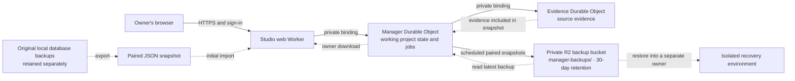

# Cloudflare-native Stage 2 work

The user chose Cloudflare-native hosting and storage on 2026-11-01. The existing Stage 2 plan assumed a persistent Linux host, so that deployment topology is superseded; the owner-only browser, durability, review and recovery acceptance requirements remain unchanged. This document records the migration boundary, not a working deployment.

## What changes

- The existing manager and evidence service use separate local `node:sqlite` databases. Local Durable Object adapters now implement their storage contracts, but neither existing database has been migrated. A Cloudflare container's disk is ephemeral by default; do not use it for these databases or assume an object-storage mount provides SQLite locking semantics.
- Cloudflare's SQLite-backed Durable Object storage uses `ctx.storage.sql.exec()` and `transactionSync()`, rather than the current `DatabaseSync` interface and explicit `BEGIN`/`COMMIT`. Preserve the single-owner, transactional state-plus-outbox and lease-fencing semantics while porting; do not mechanically swap database drivers.
- Existing manager state and immutable evidence both need durable, separately scoped storage and a verified migration. Preserve exact source bytes, checksums, project isolation, pending candidates, review history, work, jobs and outbox. Do not replace a persisted source with a newly generated version. A successful manager-only migration is insufficient.
- Evaluate Cloudflare's documented Next.js Workers integration against the existing Studio, Auth.js, route handlers and React server actions. Cloudflare currently recommends vinext for new Workers deployments and marks it beta; compatibility must be verified rather than assumed. An alternative remains possible if tests show a compatibility gap.
- A private Durable Object binding connects the Studio proxy to the manager in the Workers configuration; end-to-end verification of the latest binding transport remains outstanding. Never expose the manager or classifier as an unauthenticated public endpoint.
- Use a durable scheduling mechanism for future background work rather than assuming a container or Worker process remains alive while the browser is closed. Stage 2 does not enable GitHub mutation or autonomous delivery.

## Migration and release gates

1. Implement and test Cloudflare-native state and evidence adapters against the existing store contracts, including transaction rollback, source/version idempotency, fencing, restart and isolation. Test failures and concurrent requests against the actual Workers runtime.
2. Build an explicit, repeatable import from a consistent backup of both local stores, compare counts and checksums, and verify an isolated restore. Preserve the original backup and define a reversible cutover before any production migration.
3. Verify owner-only GitHub sign-in, same-origin reads and mutations, session expiry, CSRF, token isolation and unavailable-provider setup through the deployed runtime. Verify an unauthorized account cannot read HTML, API responses or assets containing private state.
4. Confirm account capabilities, domain, cost and OAuth setup before provisioning; deploy only after the full storage and access gates are ready. Record a private staging URL, revision, backup/restore evidence and actual timings. No account resources have been created by this design update.

References: [Cloudflare container lifecycle](https://developers.cloudflare.com/containers/faq/), [Durable Object SQL and transactions](https://developers.cloudflare.com/durable-objects/api/sqlite-storage-api/), [Cloudflare Next.js Workers guide](https://developers.cloudflare.com/workers/framework-guides/web-apps/nextjs/), and [Containers pricing](https://developers.cloudflare.com/containers/platform/pricing/).

## Local progress — 2026-11-02

Manager state, delivery state and immutable evidence each have a SQLite Durable Object adapter. The local Workers fixture in `tests/cloudflare/` exercises rollback, fencing, restart persistence, source identity and project isolation. The manager's private endpoint also passed local unsigned-request and restart checks. These are synthetic tests, not a migration or deployment. SQLite `changes()` is used for affected rows because Durable Object billing counts can include index writes.

An OpenNext Workers build and synthetic session checks have run locally. A private read-only evidence object is now connected to the manager; its deployment and real data import remain unverified. Ingestion and model-backed operations remain unavailable. Production import and backup/restore, durable scheduling, deployed sign-in and real access verification remain open. No Stage 2 issue has been closed.

## Staging address and sign-in preparation — 2026-11-02

The user selected `project-manager` as the staging name. The existing Cloudflare Workers subdomain is `ezth.workers.dev`, so the intended Workers address is `https://project-manager.ezth.workers.dev`. This address is not deployed or verified. The web Worker configuration now targets this address; no deployment has been made. The storage Worker remains without a public endpoint. The GitHub account’s registered OAuth apps did not include a project-manager app when checked. A dedicated GitHub OAuth app would use that HTTPS origin as its homepage and `/api/auth/callback/github` as its callback; real app registration, secret provisioning and sign-in tests are still required.

## Offline snapshot foundation — 2026-11-02

The snapshot module captures versioned, deterministically ordered manager and evidence SQL records and verifies their SHA-256 digests. A paired check compares each stored manager note with its referenced evidence identity, checksum, date, and exact text. Restore validates the snapshot before writing, requires empty initialized application tables, checks foreign keys and a final digest, and rolls back the destination transaction on failure. Unknown manager tables, unsupported schema versions, and incompatible column, key and foreign-key constraints are rejected.

The offline export entry point accepts **already-created, mutually consistent SQLite backup files** and a new output path: `node --import tsx src/storage/snapshot-export.ts <manager-backup.sqlite> <evidence-backup.sqlite> <new-output.json>`. Stop and drain both original services before creating those backups; the exporter cannot establish that independently captured files represent the same moment. It opens the backup files read-only, validates the pair and exclusively creates a private-permission output. Preserve the original backups separately and protect the output: it contains private project data in plaintext. The digest detects accidental changes; it does not authenticate an untrusted file.

Synthetic Node SQLite and local Workers tests cover isolated SQL restoration, failure rollback and restart. This is **not yet a hosted migration or complete backup system**: no production import endpoint, pairwise cutover coordination, deployed restore drill or timings exist. These SQL snapshots exclude Cloudflare's internal key-value data and alarms and the classifier's non-evidence tables; they must not be treated as complete backups of those stores. The current manager's persistent application data must remain confined to the captured SQL tables before this approach can be used. No user databases or Cloudflare resources were modified in these tests.

## Paired import and cutover — local implementation

The private manager and evidence objects now support a coordinated import of the paired SQL snapshots into empty stores. In import mode, the manager denies ordinary requests until both stores have been restored and verified. The manager checks both destinations before recording the lock; existing conflicting data is never overwritten. A durable marker records the exact pair and progress; if a response is lost or the process restarts, only the same pair can resume. Evidence is restored and verified before manager data, and live work in the supplied backup is rejected. The source backups remain unchanged. The authenticated `/manager/setup` page accepts the exported JSON file, with an 8 MiB limit; the same-origin proxy enforces the owner session and origin before calling the private object binding.

For a future controlled release, set the storage Worker's `MANAGER_IMPORT_MODE` to `required` before any traffic. Provision a separate strong `MANAGER_MIGRATION_TOKEN` as a secret in both the storage and web Workers; it must differ from `MANAGER_SERVICE_TOKEN`. Enable the setup page with the web Worker's `MANAGER_IMPORT_ENABLED=true`. These settings do not create an OAuth app, deploy the application, stop the original owner or make a backup. After quiescing and stopping both original services, create and retain complete, consistent SQLite backups (including the original classifier database), export the paired SQL file, and use it only after a synthetic isolated drill. Keep the original services stopped while the hosted copy is active. Following a successful import and independent source/decision/job verification, disable the web import page and remove the migration secrets. Never operate the two manager owners against divergent copies at the same time.

The import and lock have been exercised with synthetic data in local Workers, including a lost acknowledgement, a locked restart, retry and a further restart. A second local test ran the built web Worker and separate storage Worker together, using synthetic sessions, and verified owner/origin checks, import, exact evidence and persistence after restart. The paired digest does not authenticate a backup from an untrusted source. This is not yet a deployed recovery drill: live OAuth, cross-script bindings, full backup and restore, scheduled backup retention, actual timings, and release verification remain open. Do not expose a production target until those gates pass.

## Preparing the original local databases

The manager database present during the 2026-11-02 inspection predates the Stage 1 schema. After stopping both original services, the one-time helper below creates a new private directory containing complete SQLite copies, including committed WAL content and all classifier tables. It creates a separate staged manager copy and applies schema upgrades there without performing interrupted-run recovery; the original manager backup is kept unchanged.

```sh
node --import tsx src/storage/backup-pair-cli.ts /absolute/path/to/projects.sqlite /absolute/path/to/ingest-classifier.sqlite /absolute/path/to/new-backup-directory
node --import tsx src/storage/snapshot-export.ts /absolute/path/to/new-backup-directory/manager.staged.sqlite /absolute/path/to/new-backup-directory/evidence.original.sqlite /absolute/path/to/new-backup-directory/import.json
```

The helper takes SQLite write locks while making the copies and checks the canonical manager owner lock. An already-running manager using an older version of the code may hold a lock under an alias, and an idle classifier can resume writing after locks are released. Therefore, the operator must independently stop both original services and keep them stopped throughout cutover; locks alone do not establish this. Paths must be canonical, source databases must be single-link regular files, and the output directory must not already exist. If the backup contains an active run, intake or delivery attempt, the import rejects it; resolve that state on the original system before taking a fresh backup. Secure and retain the complete original backup files separately from the import JSON.

## Hosted backups and retention

The planned hosted data and recovery flow is:



The Durable Objects are the working stores; R2 holds recovery copies. The local originals are retained outside the automatic R2 retention policy. This diagram describes the intended hosted setup, not evidence that deployment or recovery has been verified.

When enabled and bound to a private R2 bucket, a Durable Object alarm captures a paired manager/evidence snapshot, verifies note/source consistency, writes it to `manager-backups/`, reads it back, and records the result. A retry is scheduled before the attempt; failures record a generic status and retry rather than depending on the browser. The manager shows backup status and lets the owner download the last verified backup, including after a later failed attempt. Snapshots larger than 8 MiB or with in-flight work are rejected rather than producing a backup the current restore path cannot safely use.

The user selected **30 days** of retention on 2026-11-02. The private Standard bucket `agents-manager-staging-backups` has a verified rule expiring only `manager-backups/` objects after 30 days. The local original SQLite backups are outside that policy. R2's published standard free tier includes 10 GB-month of storage; usage above included limits may incur charges. Configure and check actual account costs and monitor backup failures. On 2026-11-03 the owner activated R2; the bucket and rule were created and verified. The owner confirmed no spending limit or billing alert is configured and chose to proceed using the free allowance. Hosted backup execution and recovery remain unverified. See [Cloudflare R2 pricing](https://developers.cloudflare.com/r2/pricing/).

The alarm/R2 implementation has passed synthetic local Workers tests across a restart and an overdue alarm. A local restore drill using the existing backup pair passed for one project and one evidence source in 10 ms; this timing is a local observation, not a hosted recovery objective. An isolated deployed restore drill, deployed alarm behavior, owner access and external monitoring remain release gates. Evidence writes must remain disabled or coordinated through the manager's snapshot barrier; independent evidence writers require a new cross-store consistency protocol.
